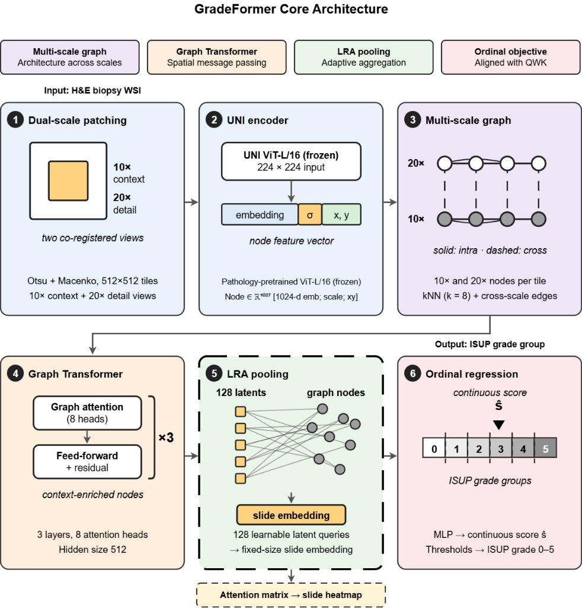
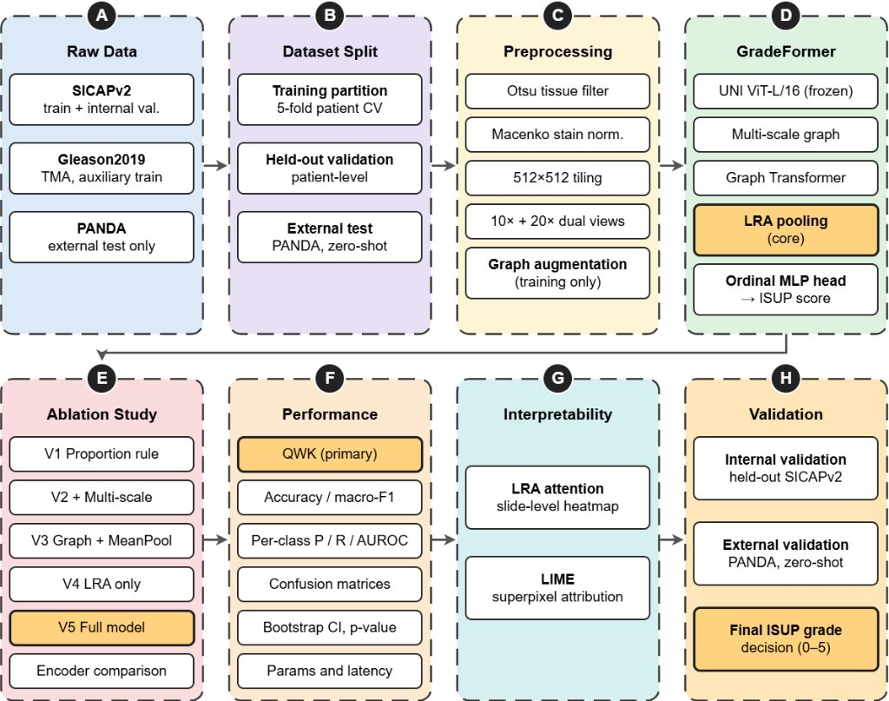
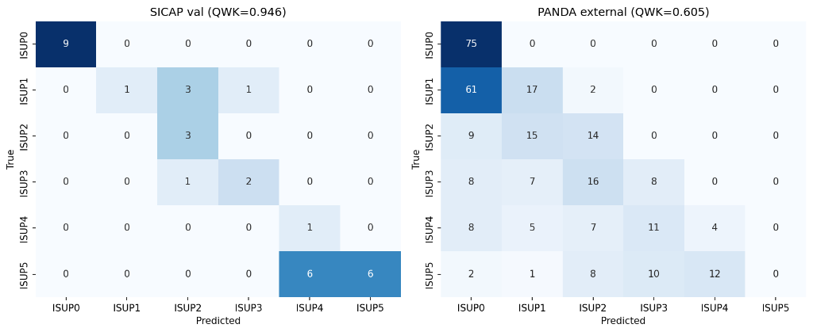
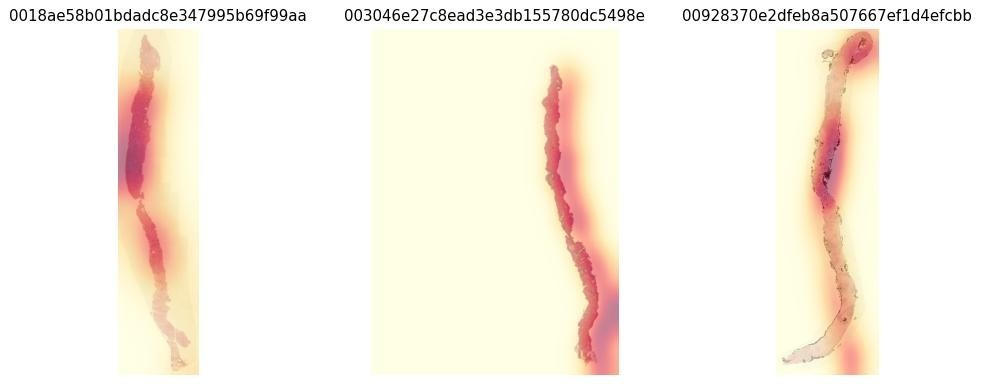
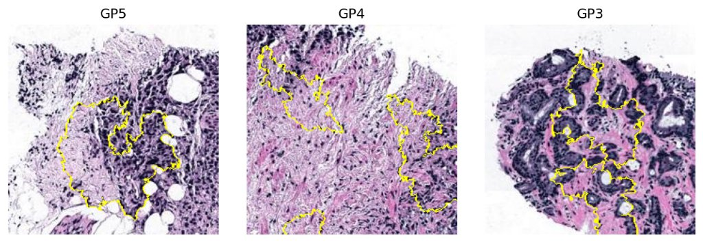
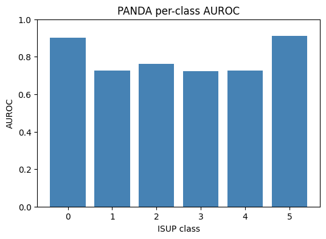

# GradeFormer

> **A Multi-Scale Slide-Graph Transformer with Low-Rank Attention Pooling for ISUP Grading of Prostate Biopsies**

[](https://www.python.org/downloads/)
[](https://pytorch.org/)
[](https://pyg.org/)
[](LICENSE)

---

## Overview

GradeFormer is a weakly supervised computational pathology pipeline designed for International Society of Urological Pathology (ISUP) grade group prediction from whole-slide prostate biopsies.

Key architectural highlights:
1. **Concentric Dual-Scale Patching:** Extracts pairs of coarse ($10\times$) and fine ($20\times$) views from each tissue patch.
2. **Foundation Feature Extraction:** Encodes patch views using a frozen pathology foundation model (UNI ViT-L/16) augmented with spatial Cartesian coordinates.
3. **Multi-Scale Graph Formulation:** Constructs a topological graph linking intra-scale spatial neighbors ($k$-NN, $k=8$) and cross-scale correspondence edges.
4. **Graph Transformer Contextualization:** Applies multi-head graph self-attention layers with residual normalization to model structural tissue context.
5. **Low-Rank Attention (LRA) Pooling:** Projects dynamic graph nodes into fixed-dimensional representations via 128 learnable latent queries.
6. **Continuous Ordinal Regression:** Maps slide representations to continuous grade predictions optimized via Mean Squared Error, followed by threshold cut-point discretization.

---

## Pipeline Architecture



*Figure 2: GradeFormer model architecture across six processing stages.*

### End-to-End Workflow



*Figure 1: Full experimental and validation workflow from raw inputs to external evaluation.*

---

## Key Results

- **Held-out SICAPv2:** Quadratic Weighted Kappa (QWK) = **0.946** (95% CI: 0.891–0.977)
- **External PANDA Benchmark (300 Biopsies):** Zero-shot QWK = **0.605** (95% CI: 0.531–0.673)
- **Multi-Seed LRA Ensembles:** External QWKs up to **0.690**
- **Exact or Adjacent Agreement:** **78.3%** on external multi-center biopsies

### Confusion Matrices



*Figure 3: Confusion matrices for held-out SICAPv2 (left) and external PANDA benchmark (right).*

---

## Interpretability & Visualizations

GradeFormer provides multi-level diagnostic transparency:
- **Slide-Level Cross-Attention Maps:** Highlight high-grade cancerous glands on needle core biopsies.
- **Superpixel Feature Attributions:** Linear probe LIME attributions verifying cellular patterns (GP3, GP4, GP5).

| Slide-Level LRA Attention Maps | LIME Superpixel Attributions |
| :---: | :---: |
|  |  |
| *Figure 4: Biopsy-level heatmaps* | *Figure 5: Gleason pattern attributions* |

### Per-Class Discriminative Performance



*Figure 6: One-vs-rest AUROC across ISUP grades 0 to 5 on external PANDA biopsies.*

---

## Repository Structure

```text
GradeFormer/
├── notebooks/
│   ├── 01_gradeformer_pipeline_and_training.ipynb     # Main training & evaluation pipeline
│   └── 02_multiseed_ensemble_and_interpretability.ipynb # Multi-seed ensembles & interpretability
├── figures/                                           # Publication-quality figures (Figs 1-6)
│   ├── figure1.png
│   ├── figure2.png
│   ├── figure3.png
│   ├── figure4.png
│   ├── figure5.png
│   └── figure6.png
├── manuscript/                                        # Complete LaTeX manuscript & references
│   ├── main.tex
│   ├── references.bib
│   └── GradeFormer_Overleaf_Package.zip
├── requirements.txt                                   # Python dependencies
├── .gitignore
└── README.md
```

---

## Installation & Setup

```bash
# Clone repository
git clone https://github.com/AMINURJOY/GradeFormer.git
cd GradeFormer

# Create virtual environment
conda create -n gradeformer python=3.10 -y
conda activate gradeformer

# Install dependencies
pip install -r requirements.txt
```

---

## Running the Notebooks

1. **Part 1 — Core Training & Evaluation:**  
   Open `notebooks/01_gradeformer_pipeline_and_training.ipynb` to run data preprocessing, graph construction, 5-fold cross-validation, and external validation on PANDA.
2. **Part 2 — Ensembling & Interpretability:**  
   Open `notebooks/02_multiseed_ensemble_and_interpretability.ipynb` to execute multi-seed ensembling, extract LRA cross-attention maps, and generate LIME superpixel attributions.

---

```

---

## License

This project is licensed under the MIT License - see the [LICENSE](LICENSE) file for details.
